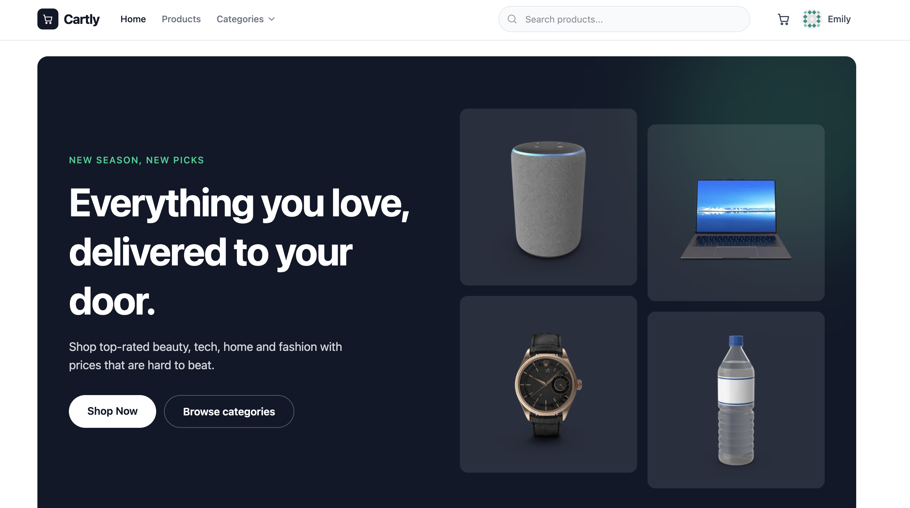
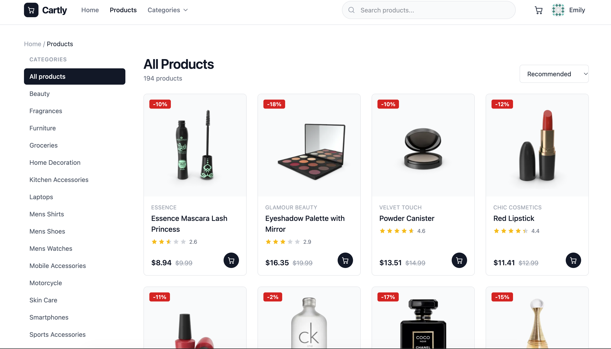

# Cartly

**A modern, fully responsive e-commerce frontend** built with React, TypeScript, Vite, and Tailwind CSS.

Shop top-rated beauty, tech, home, and fashion products with a clean UI, real-time cart, search, filtering, and authentication — powered by the [DummyJSON](https://dummyjson.com) API.

**Live Demo:** [https://e-commerce-website-gamma-blue.vercel.app](https://e-commerce-website-gamma-blue.vercel.app)

---

## Screenshot

<!-- Replace the path below with your actual screenshot -->



---

## Features

- **Beautiful Homepage**
  - Hero section with featured product imagery
  - Featured products, New Arrivals, and Hot Deals sections
  - Shop-by-Category grid
  - Customer testimonials
  - Free shipping / Easy returns / Secure checkout perks

- **Product Catalog**
  - Browse all products or filter by category
  - Full-text search
  - Sort by: rating, newest, price (low→high / high→low), biggest discount, name
  - Pagination (12 products per page)
  - Responsive product grid with loading skeletons

- **Product Details**
  - High-quality images, pricing with discount, stock status
  - Add to cart with quantity control

- **Shopping Cart**
  - Persistent cart (localStorage)
  - Quantity updates & item removal
  - Live subtotal calculation
  - Stock-aware quantity limits

- **Authentication**
  - Login with DummyJSON users
  - Session persistence
  - Protected Account page

- **UI / UX**
  - Fully responsive (mobile → desktop)
  - Clean, modern design with Tailwind CSS
  - Smooth loading states and empty states
  - Accessible navigation and controls

---

## Tech Stack

| Technology       | Purpose                          |
|------------------|----------------------------------|
| **React 19**     | UI library                       |
| **TypeScript**   | Type safety                      |
| **Vite**         | Build tool & dev server          |
| **Tailwind CSS** | Utility-first styling            |
| **React Router** | Client-side routing              |
| **Axios**        | HTTP client                      |
| **DummyJSON**    | Mock REST API (products, auth)   |

---

## Project Structure
```
src/
├── api/              # API clients (products, auth, cart helpers)
├── assets/           # Static assets
├── components/
│   ├── common/       # Shared UI (Pagination, icons, etc.)
│   ├── home/         # Homepage sections (Hero, CategoryGrid, etc.)
│   ├── layout/       # Header, Footer, Layout shell
│   ├── productDetails/
│   └── products/     # ProductGrid, cards
├── context/          # AuthProvider & CartProvider
├── hooks/            # Custom hooks (useFetch, etc.)
├── pages/            # Route pages
├── types/            # TypeScript interfaces
└── utils/            # Helpers (price, storage)text---
```
## Getting Started

### Prerequisites

- Node.js 18+ 
- npm (or yarn / pnpm)

### Installation

```bash
# Clone the repository
git clone https://github.com/Fasikagebrehana/E-Commerce-Website.git
cd E-Commerce-Website
```
```
# Install dependencies
npm install

# Start the development server
npm run devThe app will be available at http://localhost:5173.Available Scripts
```

AuthorFasika Gebrehana

GitHub: @Fasikagebrehana
